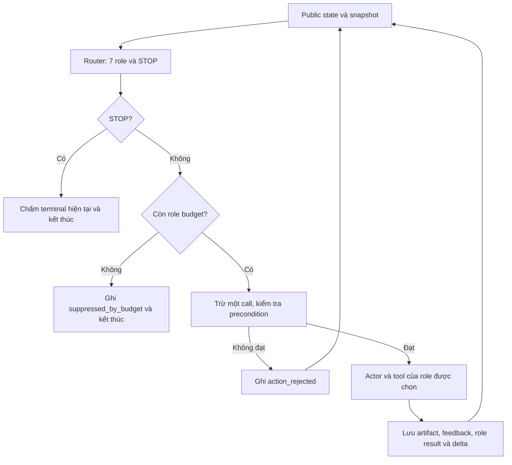

# Formal40 hiện hành: harness, runtime và luồng thông tin

Đối chiếu implementation ngày **2026-11-22**. Đọc cùng
[State và executor protocol](formal_proof_state_protocol_vi.md). Phạm vi là
bank Formal40 và profile final recovery v3/input12k/budget12, không phải đặc tả
chung cho tất cả bank formal lịch sử.

Trạng thái run/đóng gói: [Chuẩn bị release kết hợp](formal40_release_preparation_vi.md)
và [Nhận xét router/fixed](formal40_router_fixed_release_observations_vi.md).

## 1. Hai runtime, cùng giao thức

| Cohort | Lean | Mathlib commit | Packet |
|---|---|---|---:|
| `lean48` | `4.8.0-rc1` | `db651742f2c631e5b8525e9aabcf3d61ed094a4a` | 30 |
| `lean422` | `4.22.0-rc4` | `928758ac3743dc7f171fc66f450506723896f1c5` | 10 |

`public/execution_contract.json:toolchain` là nguồn chọn phiên bản, không phải
tên packet hay dataset nguồn. `resolve_runtime()` đọc contract và `lean_cache`
để chọn `lean_executable`, `project_dir`, `LEAN_PATH`; kết quả lưu trong
`episodes/<packet>/runtime.json`. Đổi tên packet không làm thay đổi cơ chế chọn
runtime, nếu manifest/path được cập nhật nhất quán theo chuẩn packet.

`run_formal_runtime_audit.py --check-only` kiểm tra manifest/integrity, số packet
của cohort, Lean binary version/hash, Mathlib checkout và runtime lock, đồng
thời kiểm tra tokenizer nếu bật formal protocol. Gate này không gọi model hay
chứng minh lại từng witness. Runtime resolution thông thường không thay thế
toàn bộ gate lock này.

Cả router và executor nhận toolchain qua public contract; executor còn nhận
source/imports, initial goal và feedback do đúng runtime sinh. Không giả định
backbone có năng lực ngang nhau trên hai Lean version. Hai cohort khác đề nên
chênh lệch điểm giữa cohort không đo riêng tác động của runtime.

## 2. Vòng lặp harness và budget

`SharedTrajectoryRunner` dùng cùng interface `reset(seed)` /
`select(observation, actions)` cho các router. Vòng lặp:

Budget final là 12 **lượt chọn role non-STOP**, không phải 12 HTTP requests.
Precondition rejection, deterministic role và lượt gặp lỗi executor sau khi
dispatch vẫn tiêu thụ call. Bounded reads trong cùng lượt và transport retries
không tạo thêm quyết định routing; chúng có accounting request/tool riêng.

Không masking precondition, không ép pipeline, không auto-STOP khi verification
pass. Router vẫn được hỏi tại budget 0: STOP được xử lý, non-STOP bị ghi
`suppressed_by_budget` và không thực thi. `PREMATURE_STOP` chỉ nghĩa STOP khi
terminal chưa đúng; tên nhãn này không bảo đảm router đã dừng trước khi dùng
hết 12 calls.

`terminal` đòi verification fresh và pass. `result.json:passed` yêu cầu terminal
và router đã chọn STOP. Một proof cuối đúng nhưng không được compile/verify
fresh trong episode vẫn có thể fail workflow, dù evaluator sau run cho pass.

## 3. Ai nhìn thấy thông tin gì?

| Thông tin | Router | Executor role sinh nội dung | Checker/preparation |
|---|---|---|---|
| Task và public execution contract/toolchain | Có | Có | Có |
| Initial goal/local context | Có | Có | Có |
| Toàn bộ role cards và remaining call budget | Có | Chỉ role đang chọn; payload không tự thêm remaining budget | Không dùng để giải proof |
| Source/candidate raw đầy đủ | Không tự nhúng | Preview tối đa 8.000 ký tự ban đầu; có thể đọc candidate theo fragment | Checker đọc source cuối |
| Compilation/verification/premises/diagnosis | Public artifact content và critical fields | Automatic bounded handoff, metadata và critical fields | Audit theo chức năng |
| Inspector report | Có khi artifact tồn tại | Bounded report tự chuyển tiếp; full trace đọc bằng artifact | Collector sinh report bằng Lean |
| Raw response/conversation của agent trước | Không tự truyền | Không tự truyền; dùng artifact/history/progress | Trajectory giữ để audit |
| Private reference/witness | Không | Không | Chỉ phần kiểm định được phép dùng |

Router snapshot gồm `task`, `current_state`, `agent_profiles`, `recent_events`,
`budget` và `constraints.allowed_actions`. Lịch sử formal được runner loại
`result` raw; giữ role/status/origin/delta và `contract_error` nếu có. Một
artifact diagnosis được chuyển tự động, khác với việc truyền toàn bộ raw
reasoning của agent trước. Cung cấp evidence không chứng minh model đã dùng nó.

Các executor roles dùng cùng backbone nhưng mỗi lượt dựng context mới theo role;
không phải nhiều model có shared chat memory. Artifact trong workspace là kênh
bàn giao chính. Compiler/Verifier/Inspector chạy deterministic tool trực tiếp.

## 4. Automatic artifact handoff và giới hạn input

`executor_context()` lấy public state, thêm source preview, tool history tóm
tắt, rồi `attach_handoff()` tự đưa artifact mới nhất của từng loại vào context:

| Evidence key | Quota preview ban đầu, ký tự |
|---|---:|
| `compilation` | 4.500 |
| `verification` | 2.000 |
| `diagnosis` | 4.000 |
| `premises` | 4.000 |
| `inspection` | 6.500 |

Mỗi mục có ID/hash/producer/input versions/freshness, `kind`, projection,
độ dài gốc/độ dài đưa vào, `truncated` và `read_ref`. Diagnosis là
`agent_assessment`; các mục tool là `tool_evidence`. Evidence stale được ghi
rõ là của input cũ, không tự nâng thành evidence cho candidate hiện tại.

Handoff v2 ưu tiên lỗi trước warning. `critical` giữ returncode, lỗi đầu tiên,
verifier checks/forbidden dependencies hoặc focused proof state. Tool evidence
được chiếu theo quy tắc cố định; diagnosis có thể bỏ paragraph prose trùng.
Không dùng LLM tóm tắt, không rút gọn/sửa Lean proof. Artifact raw và hash giữ
nguyên, các section được render riêng để tránh escape lồng nhiều lớp.

Actor đo input bằng tokenizer pin, dự phòng 512 token cho chat framing. Nếu quá
12.288 token, lần lượt giảm preview evidence dài nhất xuống tối thiểu 512 ký tự,
rồi giảm source preview xuống tối thiểu 2.000 ký tự; critical fields và metadata
không bị loại theo bước này. Vẫn quá cap thì trả `context_budget_exceeded`
trước khi gửi request. Sau bounded reads, `_query()` kiểm tra messages thực
với dự phòng 256 token; có thể từ chối request tiếp theo nếu context đã quá cap.

`read_artifact` đọc đúng artifact public đã kiểm tra path/hash, theo character
offset, tối đa 8.000 ký tự/lần và trả `next_offset`. Ba tool steps của một lượt
phải đủ cho các reads cần thiết và work product; không có quyền đọc filesystem
tùy ý. Khi chưa có candidate, `source_access.artifact` có thể là null; initial
source vẫn được preview cùng initial goal, không có công cụ đọc source bất kỳ.

Request log lưu `messages`, `executor_payload`, `delivered_evidence` sau bước
đóng gói; các read-expanded messages cũng được ghi theo request. Để xác minh
“đủ thông tin”, kiểm tra `source_access.visible_chars/total_chars`, `truncated`,
freshness và messages thật ở lượt bị lỗi, không chỉ nhìn config input12k.
Giới hạn 12k này thuộc executor; không phải cap input chung của router.

## 5. Giá trị và giới hạn của Proof State Inspector

`formal_inspection.py` chạy collector
`lean/InspectProof.lean` bằng đúng binary/LEAN_PATH của packet. Collector
elaborate source hiện tại, đọc InfoTree để lấy goals trước/sau tactic, local
context, expected/actual term types, diagnostics và vị trí. Không sửa source,
chèn tactic hoặc thử lời giải thay executor.

Collector giới hạn 512 tactic entries và 1.024 term entries. Report chọn tối đa
10 tactic states, 8 term types và 30 diagnostics; ưu tiên span hẹp quanh lỗi
đầu tiên. Full trace công khai lưu ở `inspection_trace`, khi có. Report công bố
`complete`, `partial`, `unavailable`, flags cắt dữ liệu và placeholder locations.
`complete` là trạng thái thu thập, không phải proof pass.

Cache dùng exact source hash, driver hash và runtime paths/profile. Inspector
chỉ chạy khi được chọn, không tự inspect sau mọi lần repair. Source đổi làm
report cũ stale. Zero goals hoặc elaborate thành công vẫn cần kiểm tra
placeholder, axioms và forbidden proof dependencies bằng verifier.

## 6. Thời gian chờ và lỗi

| Thành phần | Profile final | Phạm vi |
|---|---:|---|
| Executor HTTP timeout | 300 giây | Model requests; retry policy riêng |
| `runtime.compile_timeout_seconds` | 300 giây | Main source, assumptions/dependency probe, premise lookup qua `_compile()` |
| Inspector collector | 180 giây | Hardcoded hiện tại, không dùng compile timeout |
| Compile default của profile không khai báo | 180 giây | Giữ tương thích profile lịch sử |

**Khác biệt đang tồn tại:** execution contract trong packet vẫn có
`timeout_seconds: 180`, trong khi profile final thực thi compile với runtime
override 300. Adapter lấy giới hạn hiệu lực từ `runtime.compile_timeout_seconds`,
không đọc trường timeout của packet cho `_compile()`. Vì vậy không dùng riêng
contract để suy thời gian chờ hiệu lực hoặc khẳng định agent thấy con số 300.
Tài liệu này ghi nhận chênh lệch; không sửa packet đã pin hay thay cấu hình run.

Transport retries của actor chỉ áp dụng trước khi nhận content, với các status
retryable trong code; 401/403 không được retry tự động. Stream gián đoạn sau
khi có content không được gọi lại để lấy một proof khác. Không có semantic
retry sửa proof/format ngầm.

| Loại lỗi | Evidence và cách diễn giải |
|---|---|
| Lean error/type mismatch/unknown lemma/sorry/dependency bị cấm | Lỗi candidate hoặc checker từ chối; không tự coi là lỗi runtime version |
| Repetition/truncation/format | Lỗi generation/contract, có code riêng |
| Context vượt input budget | `tool_environment`; có thể chưa gửi request |
| API executor 401/403/504… | Runner ghi `executor_service`, error type, HTTP status, bounded/redacted error body và request IDs khi exception thoát actor |
| Compile timeout/OSError | `_compile()` trả `returncode=-1`, `tool_environment`; timeout chưa đủ chứng minh nguyên nhân môi trường |
| Router API exception | `router_error`, terminal `ROUTER_SERVICE_ERROR`; log hiện chỉ giữ error type |

**Giới hạn visibility lỗi API:** khi `RoleTransportError` thoát actor,
`trajectory.jsonl` giữ HTTP status/failure origin và diagnostics dịch vụ, nhưng `recent_events` formal
loại phần `result`. Router nhận status `transport_error` và delta, không được
đảm bảo nhận HTTP 401/403/504 chi tiết. Nhánh này cũng không tự tạo artifact
feedback hay cập nhật `role_progress`; executor lượt sau không chắc có chi tiết
HTTP đó. Không mô tả luồng hiện tại là chuyển tiếp đầy đủ mọi lỗi dịch vụ.

Từ bản bổ sung diagnostics 2026-11-20, `result` của transport error có
`error_body` (tối đa 8192 ký tự sau che credential), `error_body_truncated`,
`request_id` và `provider_request_ids`. Body lấy từ SDK error hoặc HTTP response;
ID lấy từ SDK/body hoặc các header trace được cho phép (`x-request-id`,
`request-id`, `x-correlation-id`, `x-amzn-requestid`, `cf-ray`). Không dump request
headers/payload; trường không có dữ liệu giữ null/map rỗng. Lỗi stream sau khi
đã nhận content lưu cùng diagnostics trong `responses[].metadata.generation_details`.
Các run cũ không thể khôi phục body đã mất. Bổ sung này chỉ thay audit logging,
không thay prompt, router visibility, retry policy, sampling hoặc budget. Dùng
run ID mới vì execution source hashes thay đổi.

## 7. Kiểm chứng, results và retry provenance

`verify_proof` kiểm tra immutable statement/context, không có sorry/admit/axiom,
compilation fresh và kernel assumptions trong allowlist. Adapter v2 còn duyệt
transitive proof dependencies để loại target gốc/lemma phụ thuộc target bị cấm.
Compiler pass riêng lẻ chưa đủ; không so proof text với private witness để chấm.

`evaluate_shared_environment.py` dựng checker workspace riêng, nộp source cuối,
compile và verify lại bằng runtime tương ứng. Kết quả không quay vào episode.
`ProofPass` của bảng tổng hợp là final audit pass; `Success` yêu cầu thêm
`result.passed` của workflow. Recovery trong bảng đã dùng là episode có compile/
verify proof failure rồi đạt Success; các opportunity sets có thể khác theo router.

Evaluator đánh dấu `infrastructure_failure` nếu trajectory có router error,
executor service failure hoặc tool-environment failure theo các trường nó xét.
Nhãn này có thể cùng tồn tại với Success. Bảng tổng hợp còn tính audit null/
unavailable vào cột Infrastructure; không đồng nhất cột này với số task fail.
Compile timeout có thể do proof/tactic tốn tài nguyên, cần tách khỏi HTTP errors.

Giới hạn hiện tại của evaluator: nhánh formal nhận compile environment failure
là `UNAVAILABLE`; environment failure ở kernel probe cần xem evidence vì output
verify có thể được ghi `FAIL`. Inspector unavailable cũng không luôn có trường
`failure_origin` mà detector infrastructure đọc. Không dùng cột tổng hợp thay
việc kiểm tra error evidence cụ thể.

Run lưu `resolved_config.json`, `role_cards.json`, `source_hashes.json`,
`freeze_verification.json`; mỗi episode có `runtime.json`, `decisions.jsonl`,
`decision_states.jsonl`, `trajectory.jsonl`, `result.json`, workspace/artifacts
và kết quả evaluator khi đã chạy. Source hash manifest không phải source snapshot
zip tự động của entry point hiện tại. Resume kiểm tra source/config khớp, bỏ qua
episode đã có result và từ chối workspace dang dở thay vì reset ngầm.

Chạy lại lỗi API bằng run ID mới và cùng frozen settings/selection; giữ attempt
gốc. Không dùng `--resume` để kỳ vọng chạy lại episode đã hoàn tất. Khi hợp nhất
results, chọn attempt theo quy tắc lỗi đã định trước, không chọn cái có pass cao
hơn. Tách clean benchmark result, service reliability và compile timeout.

## 8. Entry points và tài liệu nguồn

- [Runner và budget/STOP](../routing_benchmark/v4/execution/shared_runner.py).
- [Actor chung và tool loop](../routing_benchmark/v4/execution/shared_actor.py).
- [Automatic handoff](../routing_benchmark/v4/execution/formal_handoff.py).
- [Inspector](../routing_benchmark/v4/execution/formal_inspection.py).
- [Runtime resolution](../routing_benchmark/v4/execution/runtime.py).
- [Independent final evaluator](../routing_benchmark/v4/execution/final_evaluation.py).
- [Infrastructure detector và report](../scripts/evaluate_shared_environment.py).
- [Runtime audit gate](../scripts/run_formal_runtime_audit.py).
- [Shared runner CLI](../scripts/run_shared_environment.py).
- [Wrapper hỗ trợ SOL và các decision routers](../scripts/run_shared_environment_sol.py).

`run_formal_runtime_audit.py` lọc cohort rồi gọi shared runner gốc, chỉ phù hợp
router type mà factory gốc hỗ trợ. Với bốn router của batch final, đã dùng
`run_shared_environment_sol.py` cho cùng đường chạy; wrapper thêm `llm` router
và delegate decision routers về factory gốc. Wrapper không tự lọc
`runtime_audit`: phải truyền `--packet` rõ ràng từ cohort đã kiểm định.
`selected_packets` trong resolved config là bằng chứng selection thực tế.

Fixed baseline cùng môi trường: xem
[Formal40 fixed baseline với Pythagoras, budget 12](formal40_fixed_baseline_vi.md).
Hai config mới chỉ thay router bằng predefined workflow; runtime audit report
hỗ trợ tên policy khi router không có model. Đây là literal fixed sequence,
không phải policy có gating theo compiler status.

Các tests liên quan: `test_formal_handoff.py`, `test_formal_presentation.py`,
`test_formal_resource_limits.py`; preflight ở
`scripts/check_formal_executor_protocol.py`. Native witness smokes đo khả năng
hoạt động của harness, không phải performance model. Lần cập nhật tài liệu này
chỉ đối chiếu code/config, không chạy hosted model hoặc tạo trajectory mới.
